<p align="center">
  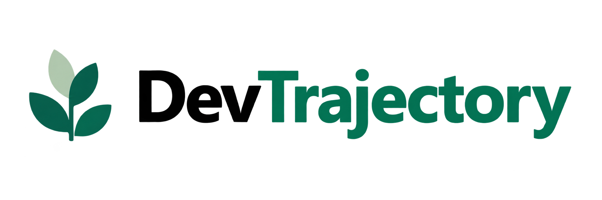
</p>

<p align="center">
  <strong>AI-powered personalized learning paths for tech careers</strong>
</p>

DevTrajectory helps people turn a career goal into a structured and actionable learning journey based on their current experience, background, and available study time.

Instead of searching through disconnected resources and wondering what to learn next, users receive a personalized learning path, explore a structured roadmap, track their progress, and manage their learning profile in one guided experience.

Built by **Chingu Voyage 62 — Tier 2 — Team 25**.

---

## 🚀 Live Product

**Try DevTrajectory:**  
👉 [https://devtrajectoryai.netlify.app/](https://devtrajectoryai.netlify.app/)

---

## 👀 Product Preview

DevTrajectory guides the user from a career goal to a personalized learning journey.

### Home

<p align="center">
  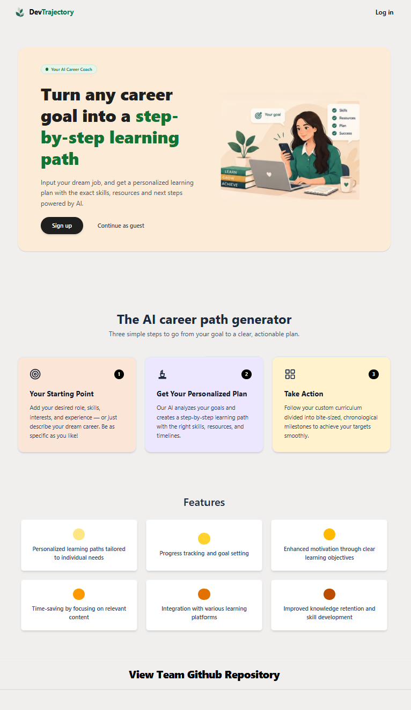
</p>

### Define the Starting Point

Users provide their career goal, skill level, background, and available time so the experience can be tailored to their situation.

<p align="center">
  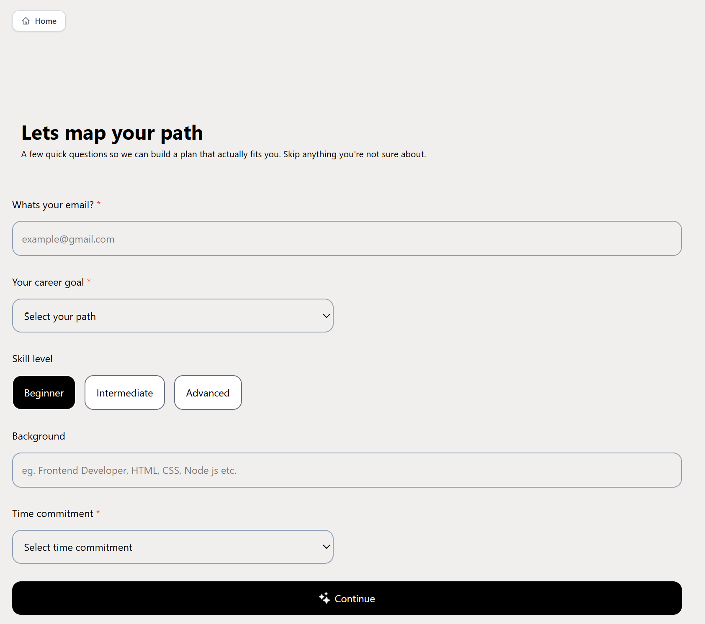
</p>

### Personalized Learning Path

After the assessment, Gemini generates a structured roadmap with stages, skills, recommended resources, and a clear timeline.

<p align="center">
  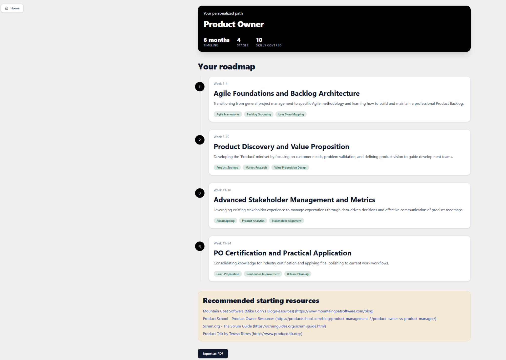
</p>

<details>
<summary><strong>See the complete product journey</strong></summary>

<br>

#### Create an Account

<p align="center">
  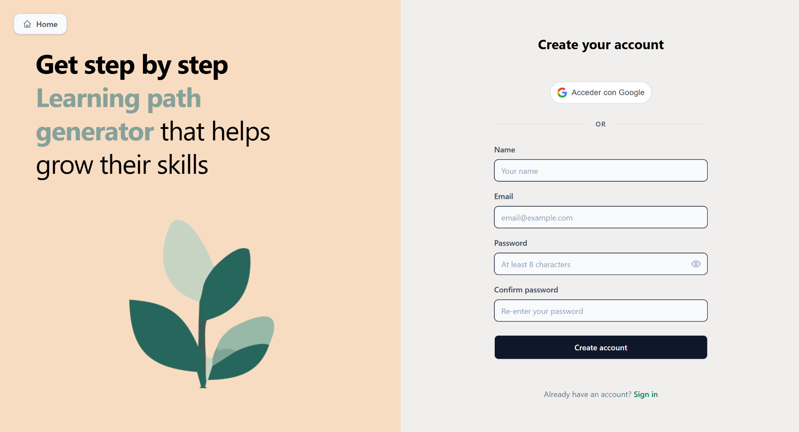
</p>

#### Sign In

<p align="center">
  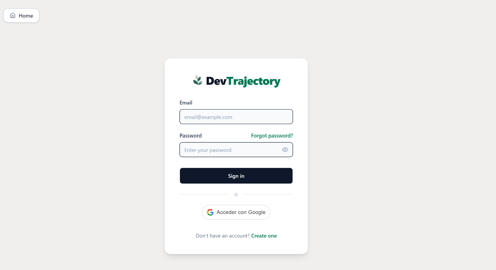
</p>

#### Learning Profile

<p align="center">
  
</p>

#### Career Assessment

<p align="center">
  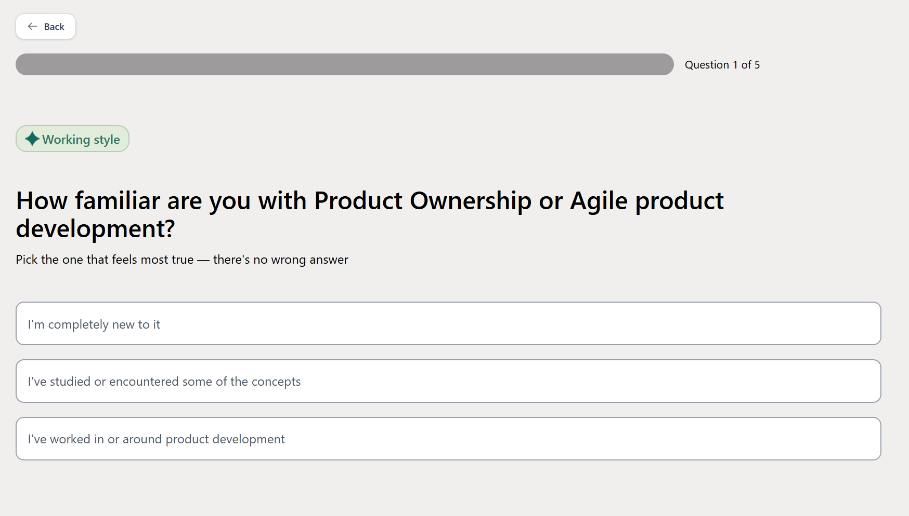
</p>

#### Review the Assessment

<p align="center">
  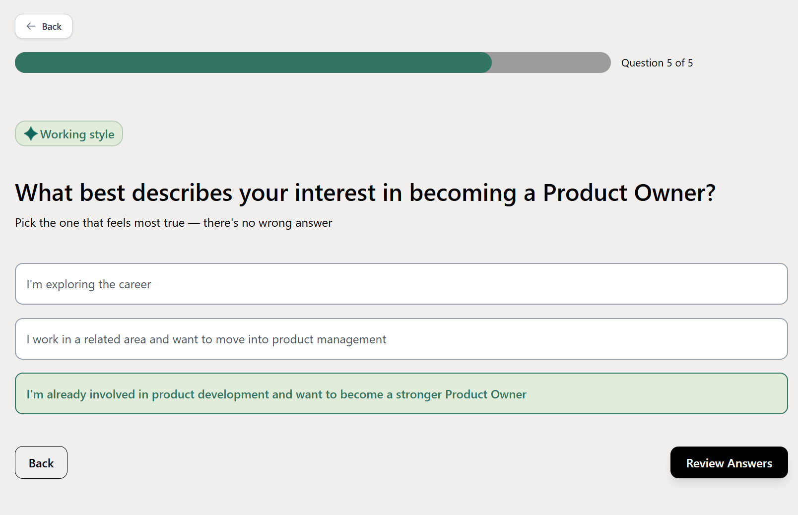
</p>

#### Generate the Path

<p align="center">
  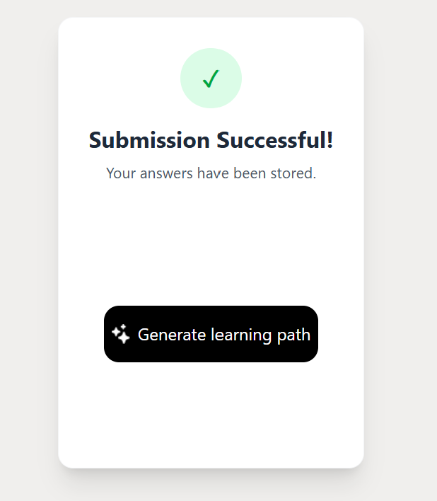
</p>

#### Learning Path Result

<p align="center">
  
</p>

#### User Profile

Authenticated users can review and edit their personal learning information from a dedicated profile page.

<p align="center">
  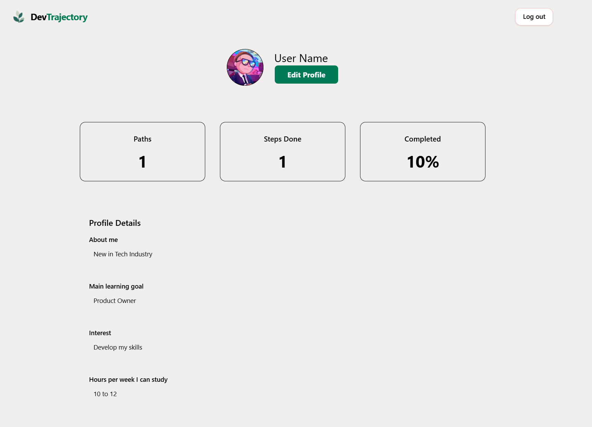
</p>

> **Final scope note:** this screenshot reflects an earlier profile iteration that included progress-statistics cards. The final User Profile focuses on editable personal information. Progress Tracking remains part of the learning-path experience, while Saved Paths / History (US-07) was cancelled.

</details>

---

## 🎯 The Challenge

People moving into a new technology role often know **where they want to go**, but not necessarily **how to get there**.

There is no shortage of courses, tutorials, certifications, and learning resources online. The real challenge is turning those resources into a realistic plan:

- What should I learn first?
- Which skills are relevant to my goal?
- How does my current experience affect where I should start?
- How much can I realistically learn with the time I have?
- How can I turn a broad career goal into a practical learning sequence?

DevTrajectory was designed around that problem.

---

## 💡 Our Solution

DevTrajectory creates a guided learning experience around each user's career goal.

Users provide information about their:

- target career,
- current skill level,
- professional or technical background,
- and available study time.

They then complete a short role-specific assessment.

Using this information, **Google Gemini AI** generates a structured learning path containing milestones, activities, and learning recommendations.

From there, users can review their roadmap, track completed learning activities, update their profile information, and print or save their learning path as a PDF.

---

## ✨ Core Experience

### 🧭 Personalized Learning Paths

Learning paths are generated around the user's career goal, experience level, background, and learning availability.

### 📝 Career Assessment

Before generating a path, users complete a short multiple-choice assessment to provide additional context about their current knowledge.

### 🤖 AI-Powered Recommendations

Google Gemini is used to transform user information and assessment responses into a structured learning journey.

### 🗺️ Structured Milestones

Learning paths break larger career goals into smaller stages, milestones, and actionable learning activities.

### ✅ Progress Tracking

Users can mark learning activities as complete and continue tracking their progress within the learning-path experience.

### 👤 User Profile

Authenticated users can view and edit their personal learning profile, including:

- About Me
- Main Learning Goal
- Interests
- Study Hours Per Week

The profile provides a dedicated space for each user to keep their learning information current and relevant to their career journey.

### 🔐 Authentication

Users can access DevTrajectory through:

- Google authentication
- Email and password authentication

### 🖨️ Print or Save as PDF

The learning path can open the browser print experience, allowing users to either:

- print their learning plan, or
- save it locally as a PDF.

### 📱 Responsive Experience

The final release is tested across desktop, tablet, and mobile layouts.

---

## 👣 User Journey

1. A user visits DevTrajectory.
2. They create an account or sign in.
3. They define their career goal, current level, background, and learning availability.
4. They complete a short career assessment.
5. Gemini generates their personalized learning path.
6. They explore the recommended stages, activities, and milestones.
7. They mark learning activities as complete and track their progress.
8. They can review and edit their User Profile.
9. Their learning path can be printed or saved as a PDF.

---

## 📌 Product Scope

The team followed an **MVP-first approach**, continuously evaluating product value, delivery capacity, and release risk.

| Story | Product Capability | Final Status |
| --- | --- | --- |
| US-01 | Landing Page & Guest Navigation | ✅ Completed |
| US-01A | UI Polish & UX Improvements | ✅ Completed |
| US-02 | User Input Form, State & Validation | ✅ Completed |
| US-02B | AI API Integration & System Feedback | ✅ Completed |
| US-06 | User Authentication | ✅ Completed |
| US-03 | Learning Path Display & Milestones | ✅ Completed |
| US-04 | Progress Tracking | ✅ Completed |
| US-05 | Print / Save as PDF | ✅ Completed |
| US-07B | User Profile & Personalization | ✅ Completed |
| US-07 | Saved Paths & History Dashboard | ⛔ Cancelled |
| US-08 | Custom Milestones & Path Editing | ⛔ Cancelled |
| US-09 | Production Release, QA & Responsive Validation | ✅ Completed |

---

## 🧠 Product Decisions

Not every idea became part of the final product.

As the Voyage progressed, the team deliberately reduced scope where additional functionality could put the stability of the MVP at risk.

**User Profile & Personalization (US-07B)** was completed as a smaller, focused profile-management experience that strengthened the MVP without adding unnecessary release risk.

**Saved Paths & History (US-07)** was cancelled when the team determined that introducing it in the closing phase could create unnecessary deployment and stability risk.

**Custom Milestones & Path Editing (US-08)** was also cancelled and kept outside the final scope.

**Progress Tracking (US-04)** remained completed in the delivered product scope, while the team still chose to keep the final release focused and avoid expanding related follow-on functionality late in the Voyage.

For export functionality, the team retained the most useful and achievable experience: **Print / Save as PDF**, while additional Markdown export and social sharing concepts were not pursued.

The final phase of the Voyage was intentionally focused on:

- completing the core MVP,
- merging stable functionality,
- production deployment,
- end-to-end testing,
- responsive validation,
- bug fixing,
- documentation,
- and Showcase readiness.

The goal was not to deliver the largest possible feature set.

The goal was to deliver a product that worked.

---

## 👥 Team 25

<p align="center">
  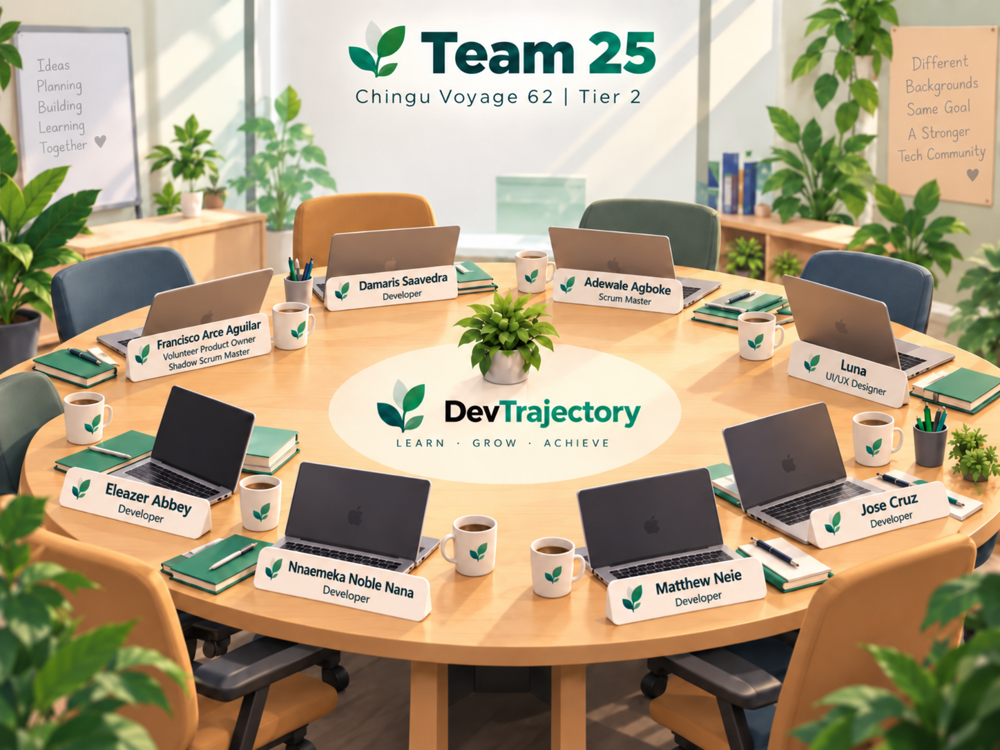
</p>

DevTrajectory was created by a distributed, cross-functional team collaborating across different countries, backgrounds, and time zones.

Every member contributed to the delivery of the product.

| Team Member | Role | Connect |
| --- | --- | --- |
| **Adewale Agboke** | Scrum Master | [GitHub](https://github.com/Adewal246) · [LinkedIn](https://www.linkedin.com/in/adewaleagboke) |
| **Damaris Saavedra** | Developer | [GitHub](https://github.com/damarisaavedra25) · [LinkedIn](https://www.linkedin.com/in/damaris-saavedra/) |
| **Matthew Neie** | Developer | [GitHub](https://github.com/MatthewNeie) · [LinkedIn](https://www.linkedin.com/in/matthew-neie) |
| **Francisco Arce Aguilar** | Volunteer Product Owner / Shadow Scrum Master | [GitHub](https://github.com/Apai-23) · [LinkedIn](https://linkedin.com/in/francisco-arce-aguilar) |
| **Jose Cruz** | Developer | [GitHub](https://github.com/cruz3196) · [LinkedIn](https://www.linkedin.com/in/jose-cruz-6056322b3) |
| **Ling Dong (Luna)** | UI/UX Designer | [GitHub](https://github.com/Luna4423-arch) · [LinkedIn](https://www.linkedin.com/in/ling-dong-801b131aa/) |
| **Eleazer Abbey** | Developer | [GitHub](https://github.com/abbey-eleazer) · [LinkedIn](https://linkedin.com/in/eleazer-abbey) |
| **Nnaemeka Noble Nana** | Developer | [GitHub](https://github.com/Noble-Nana7) · [LinkedIn](https://www.linkedin.com/in/n-noble) |

The different roles provided areas of focus and accountability, but delivery remained a shared team responsibility.

---

## 🤝 How We Worked

DevTrajectory was delivered by a distributed, cross-functional team using a Scrum-based workflow throughout Chingu Voyage 62.

We used two complementary collaboration spaces:

- **Mural** for product thinking, team alignment, backlog refinement, Sprint Planning, Sprint Review, and Retrospectives.
- **GitHub Projects** for execution tracking, development tasks, estimates, Sprint assignments, Pull Requests, and delivery status.

Together, these tools connected product decisions with day-to-day execution.

### Product Vision & Backlog

<!-- Add final Product Vision & Backlog image as docs/images/mural-product-vision-backlog.png -->

<p align="center">
  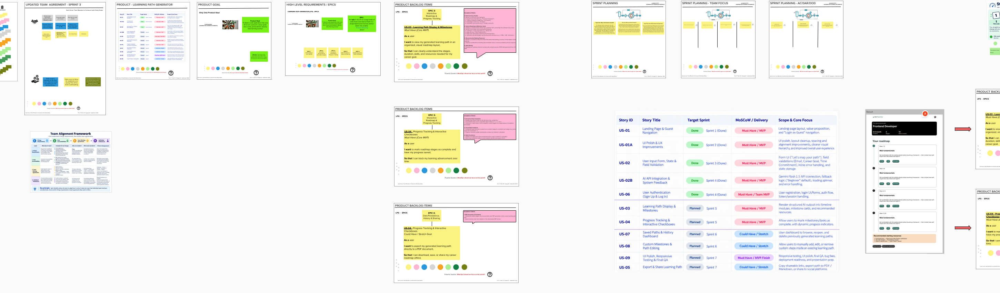
</p>

*The team used Mural to align around the Product Goal, Epics, User Stories, Acceptance Criteria, and evolving MVP scope.*

### Scrum in Mural — Sprint 5 Example

<!-- Add the Sprint 5 Mural overview as docs/images/mural-sprint5-scrum-workflow.png -->

<p align="center">
  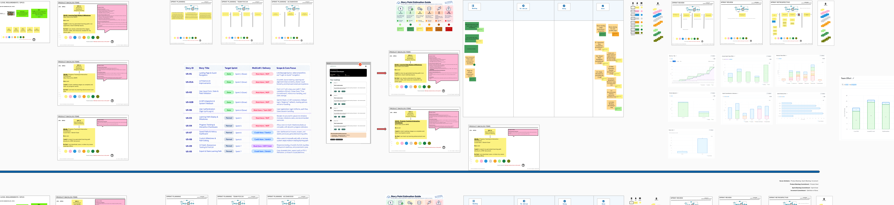
</p>

*Sprint 5 is shown as a representative example of how Team 25 managed Scrum visually in Mural—from Sprint Planning and the Sprint Backlog through execution, Sprint Review, and Retrospective.*

### Continuous Adaptation

The original scope was not treated as a fixed specification.

Throughout the Voyage, the team refined requirements, clarified Acceptance Criteria, adjusted priorities, and reduced scope when necessary to protect the quality and stability of the final MVP.

This inspect-and-adapt approach influenced decisions such as:

- simplifying export functionality to Print / Save as PDF,
- completing a focused User Profile experience (US-07B),
- cancelling Saved Paths & History (US-07) when its late introduction increased release risk,
- cancelling Custom Milestones & Path Editing (US-08),
- and prioritizing deployment, QA, responsiveness, bug fixing, documentation, and Showcase readiness during the final Sprint.

---

## 🛠️ Tech Stack

### Frontend

- React
- Vite
- Tailwind CSS

### Backend & AI

- Netlify Functions
- Node.js
- Google Gemini API
- Google GenAI SDK

### Authentication & Data

- Google OAuth
- Email / Password Authentication
- Firebase

### Design & Product Collaboration

- Figma
- Mural
- GitHub Projects
- GitHub

### Deployment

- **Production application:** Netlify
- **Live URL:** [https://devtrajectoryai.netlify.app/](https://devtrajectoryai.netlify.app/)

---

## 💻 Run DevTrajectory Locally

### Prerequisites

You will need:

- Node.js 20+
- npm
- a Google Gemini API key
- a Google OAuth Client ID

### Clone the repository

```bash
git clone https://github.com/chingu-voyages/V62-tier2-team-25.git
cd V62-tier2-team-25/vite-project
```

### Install dependencies

```bash
npm install
```

### Configure environment variables

Create a `.env` file inside `vite-project` and add the environment variables required for local development:

```env
GEMINI_API_KEY=your_gemini_api_key
VITE_GOOGLE_CLIENT_ID=your_google_oauth_client_id
```

Never commit real API keys or credentials to the repository.

### Run the full application locally

DevTrajectory uses Netlify Functions for AI generation and authentication endpoints. To run the Vite frontend together with the local Netlify Functions environment, use:

```bash
npx netlify dev
```

### Frontend-only development

If you only need to work on the React interface without the Netlify Functions, run:

```bash
npm run dev
```

The Vite development server is configured to run on:

```text
http://localhost:5177
```

---

## 📂 Repository Structure

```text
V62-tier2-team-25/
│
├── docs/
│   └── Team and Sprint documentation
│
├── vite-project/
│   ├── public/
│   │
│   ├── netlify/
│   │   └── functions/
│   │
│   ├── src/
│   │   ├── Pages/
│   │   ├── components/
│   │   ├── context/
│   │   ├── api/
│   │   ├── data/
│   │   ├── firebase/
│   │   ├── layout/
│   │   ├── lib/
│   │   └── server/
│   │
│   ├── netlify.toml
│   └── package.json
│
├── Product Backlog
├── Product Requirements
├── Use Case Documentation
├── Team Guide
└── README.md
```

---

## 📚 Project Documentation

The repository also contains artifacts created throughout the Voyage, including:

- Product Backlog
- Requirements & Specifications
- Use Case Diagrams
- Team Guide
- Sprint Planning documentation
- Sprint Reviews
- Sprint Retrospectives
- Team Decision Log

Together, these artifacts document both the final product and the process used to deliver it.

---

## 🧪 Release Quality

Before final submission, the team completed a dedicated release and QA phase covering:

- end-to-end MVP testing,
- authentication,
- AI generation,
- learning path interaction,
- User Profile functionality,
- Print / PDF functionality,
- responsive behavior,
- production deployment,
- navigation,
- and critical bug resolution.

Lower-priority functionality was allowed to remain outside the release when adding it could reduce product stability.

---

## 🌱 What We Learned

DevTrajectory was more than a coding exercise.

The Voyage required a distributed group of people to transform an initial product idea into a working application while balancing user needs, technical challenges, delivery capacity, and time.

Some of the most important lessons were:

- clear Acceptance Criteria reduce ambiguity,
- backlog refinement continues throughout development,
- scope is a tool, not a promise,
- communication becomes even more important in distributed teams,
- Pull Requests provide both technical control and project visibility,
- quality sometimes requires saying **no** to additional features,
- and completing a stable MVP can create more value than partially completing a larger product.

---

## 🙌 Acknowledgements

DevTrajectory was created during **Chingu Voyage 62** by **Tier 2 — Team 25**.

Thank you to Chingu for creating an environment where people from different backgrounds and locations can collaborate on a real software product.

And thank you to every member of Team 25 for the time, ideas, development work, design, discussions, challenges, decisions, and collaboration that made DevTrajectory possible.

**Built together. Shipped together. 🌱**
